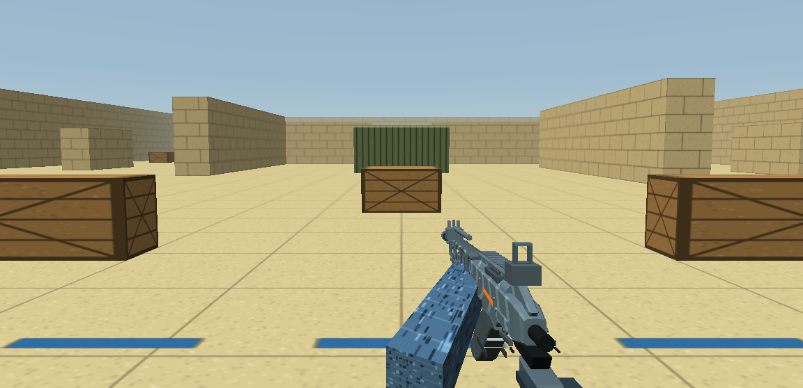
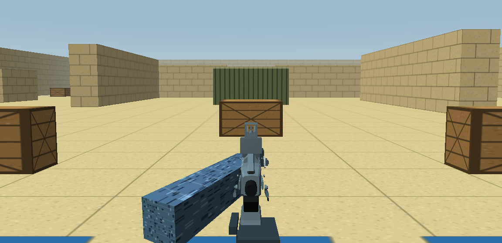
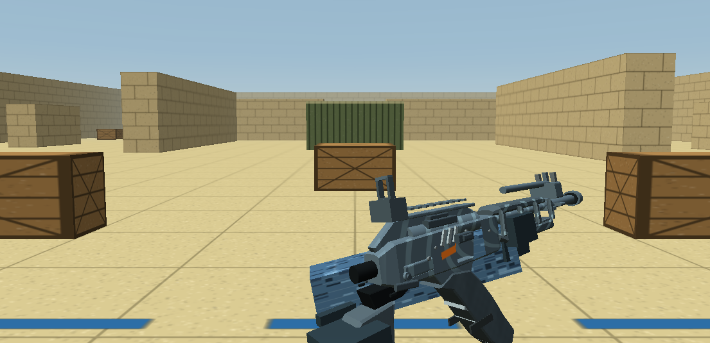
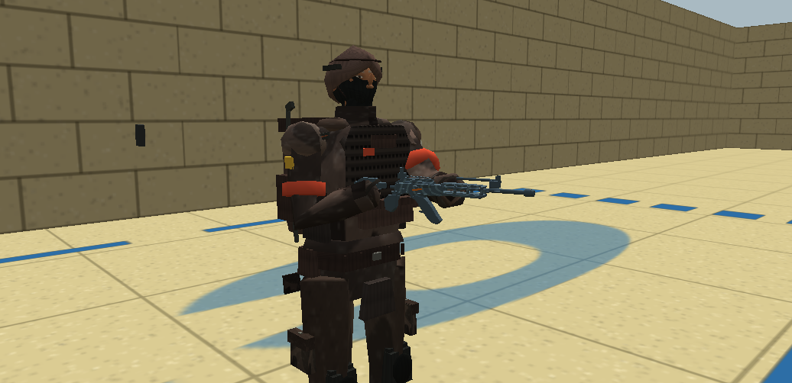

# Contour Relay visual review

Isolated Sightline V3 renderer captures from the Contour Relay candidate built on [3b8e0d9](https://github.com/Nschess/SightlineV3/commit/3b8e0d9cc563a67f7c7eb0bdfb5af2f325ce3d85). The finish awaits owner visual approval. This branch carries review evidence only.

| Hip-fire | ADS |
| --- | --- |
|  |  |
| **Inspect** | **Third person** |
|  |  |

## What the review covers

- The first-person frames use Sightline’s actual Tactical map, stock weapon pose, Ashline iron sight and inspect action. The third-person frame uses the existing posed world mesh and the remote-player finish route.
- Isolated checks in both asset-tree previews covered the stock weapon geometry, grip and muzzle anchors, stats, saved finish ID, material restoration, ADS, reload and firing. See [verification.json](verification.json) and [SHA-256](SHA256SUMS.txt). Live LAN and Android device acceptance remain open.
- Contour Relay adds an independently authored procedural slate material, abstract contour lines and an amber stripe over the existing Sightline procedural ROOK117 chassis. No imported imagery, mesh, texture, audio or custom effect was added. The candidate uses stock Sightline optics, animations, audio and effects. Emerald Revenant’s distinct art, audio and effects are outside this candidate. The owner’s base-game contributor rights and the existing Three.js MIT notice remain part of release evidence. [Source rights inventory](https://github.com/Nschess/SightlineV3/blob/3b8e0d9cc563a67f7c7eb0bdfb5af2f325ce3d85/RIGHTS-INVENTORY.md)

## Approval and production gates

**Appearance — requires owner approval.** After approval, scope integration to ROOK117’s cosmetic paths and carry forward saved finish ID rook117-3. Check mixed-client presentation, restore-to-Factory, the protected checkpoints and absence of the old cosmetic in the final package before promotion.

**Soundtrack — blocked.** The available workspace lacks a production DAW session, documented original sounds and an authorized professional producer. The [existing commission brief](https://github.com/Nschess/SightlineV3/blob/3b8e0d9cc563a67f7c7eb0bdfb5af2f325ce3d85/docs/SIGNATURE-THEME-PRODUCTION-BLOCKER.md#original-commission-brief-for-owner-approval) is the production handoff. Approve the producer and scope, secure separate composition and recording permissions and ingredient terms, then review the session, stems, loop and exact audition master. Record approval and the master’s SHA-256 before integration. The current soundtrack is commercially uncleared.

**Philippine naming screen — pending.** The published SIGHTLINE application 4/2023/00515020 covers eyewear in class 9 and refers to a glasses device. Sightline’s launcher chevron and ring reticle still need a separate figurative search. The indexed Gazette search for Quaylock and Quay Lock yielded a near spelling, QUIKLOCK application 4/2022/00508749 for bags in class 18. The records establish publication. Current status, complete game-software and game-service searches, territory scope and owner naming decisions remain open. Search the word variants and logo devices with IPOPHL, including classes 9 and 41 as applicable, and obtain the case disposition from its registry. [SIGHTLINE Gazette](https://onlineservices.ipophil.gov.ph/tmgazette/Unlimited/Attachment/JO_20240103_National.PDF) · [QUIKLOCK Gazette](https://onlineservices.ipophil.gov.ph/tmgazette/Unlimited/Attachment/JO_20220830_National.PDF) · [IPOPHL registry contacts](https://www.ipophil.gov.ph/contact-main-office/)

**Contributor evidence — pending.** Record the base ROOK117 and retained character, Legendary and map source authors and commercial grants against the current rights inventory. For Emerald Revenant, the smallest close-out is either an original Verdant archive with permission for the actual shipped derivative or owner-approved replacement and verified exclusion. Keep the archived version available for rollback.
