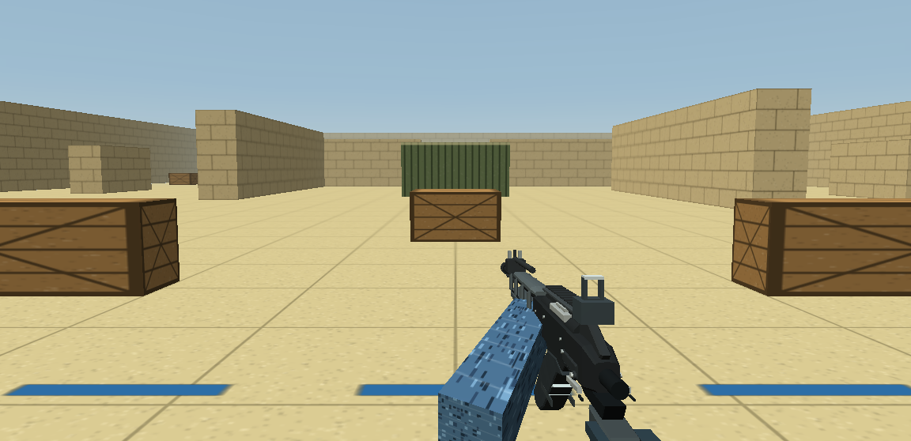
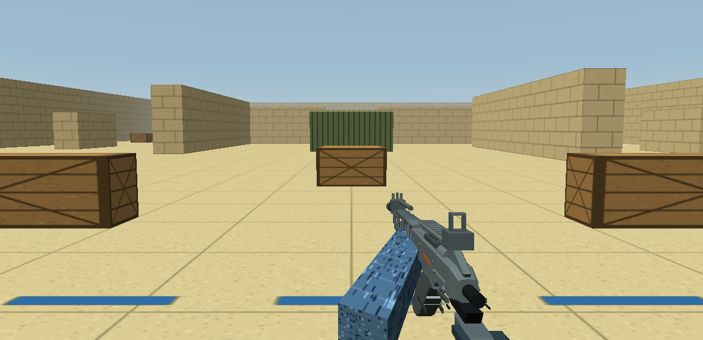
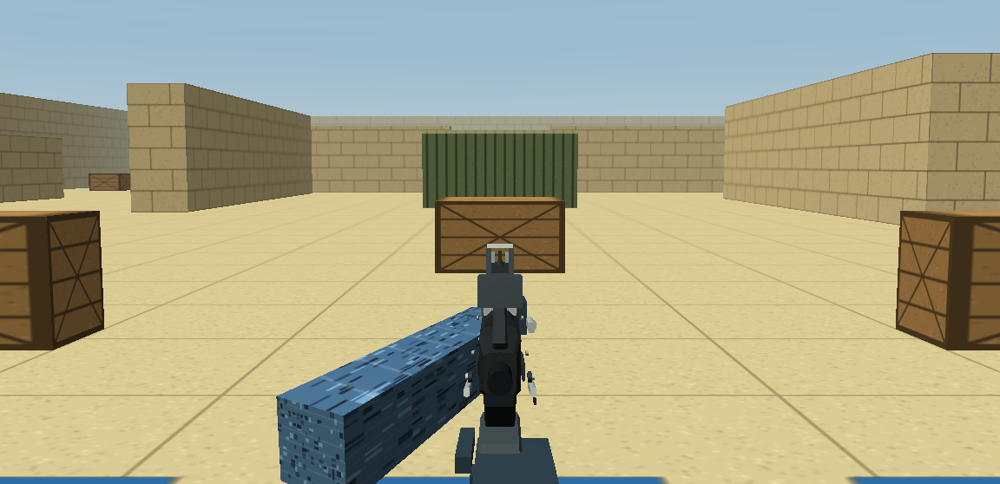
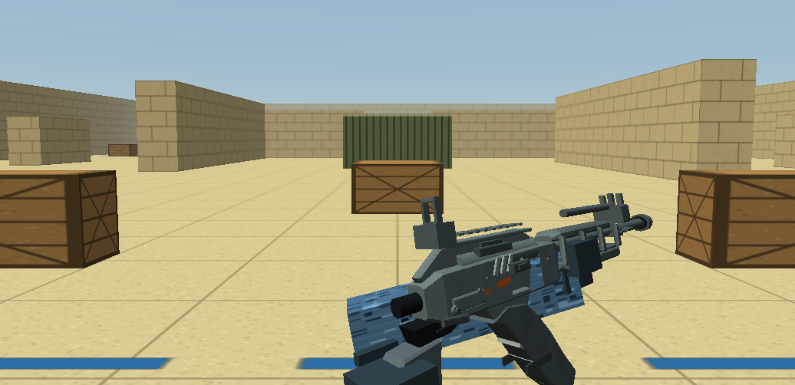
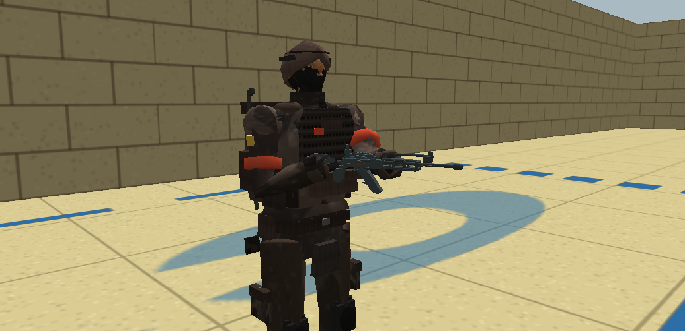

# Contour Relay final refinement

Owner review candidate on Sightline source [3b8e0d9](https://github.com/Nschess/SightlineV3/commit/3b8e0d9cc563a67f7c7eb0bdfb5af2f325ce3d85). The direction has been accepted. The revised appearance is awaiting integration approval.

## Hip-fire

| Factory | Contour Relay |
| --- | --- |
|  |  |

## Aim down sights

| Factory | Contour Relay |
| --- | --- |
|  |  |

## Revised finish

| Inspect | Third person |
| --- | --- |
|  |  |

Each Factory/Contour Relay pair was captured within one renderer step. Drawing-buffer dimensions, camera transform and projection, FOV, viewmodel transform, optic and ADS state matched. Hits in the lower-left ADS area identify the stock support-arm sleeve. The same visible sleeve geometry and materials were present in both finishes. The sleeve and weapon geometry were preserved.

The revised finish uses a more neutral, rougher slate, lower-contrast contour lines and a short muted amber stripe with a registration tick. First-person and third-person use the same palette and contour field. The isolated test covered Factory restoration, existing saved finish rook117-3, geometry and anchors, stock iron-sight alignment, reload, firing and the remote-player finish path. See [verification](verification.json) and [image checksums](SHA256SUMS.txt). Live LAN and device acceptance remain open.
